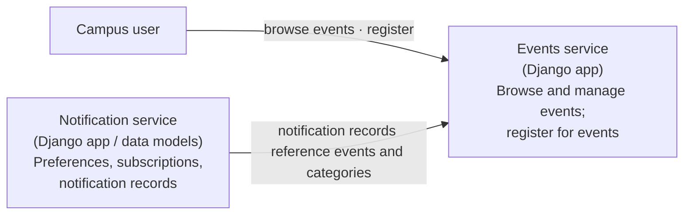

# Campus Notifier services

Both apps currently run inside the same Django application and use the same configured database. The notification app has data models, but no user-facing endpoints or delivery worker yet, so events do not trigger outgoing notifications.
